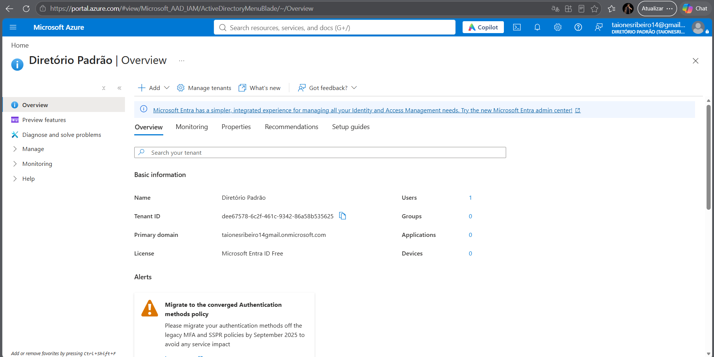
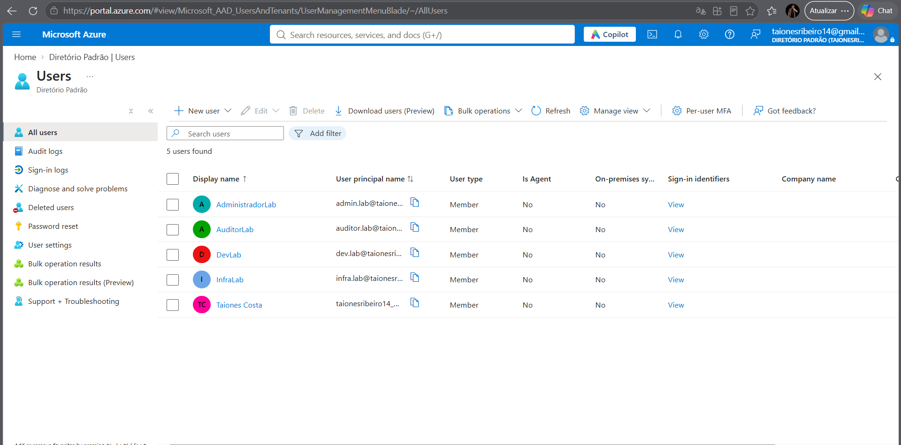
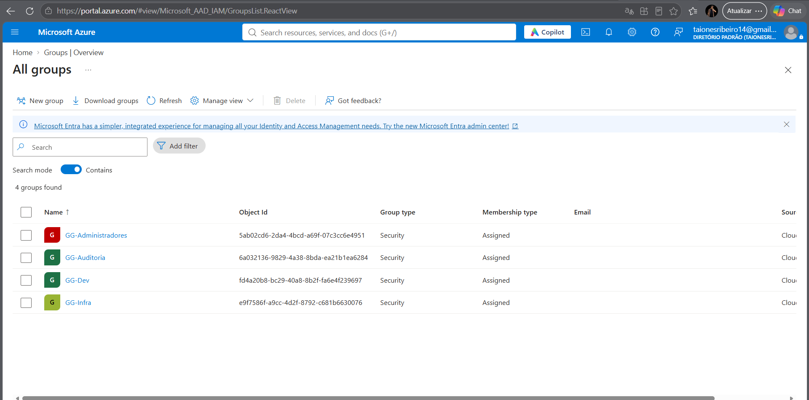
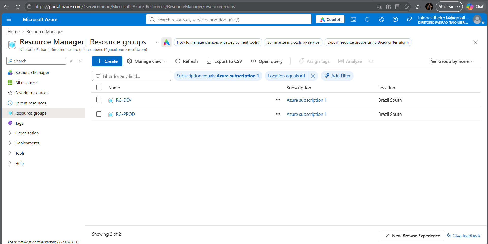
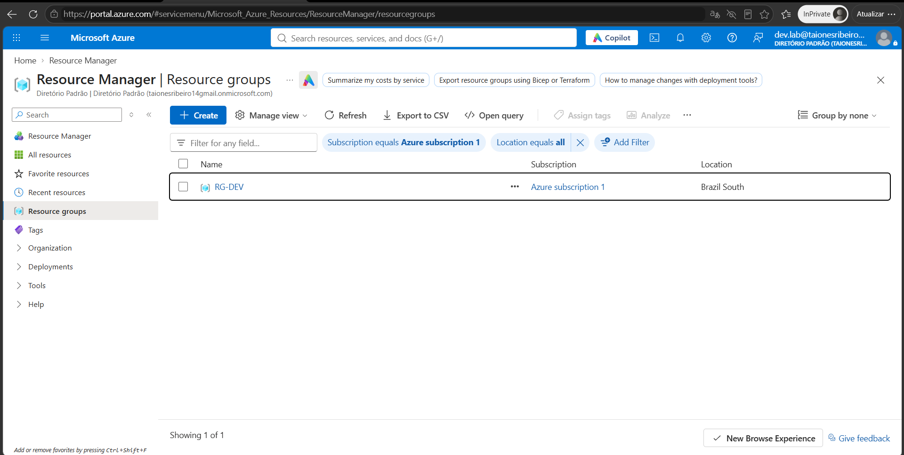
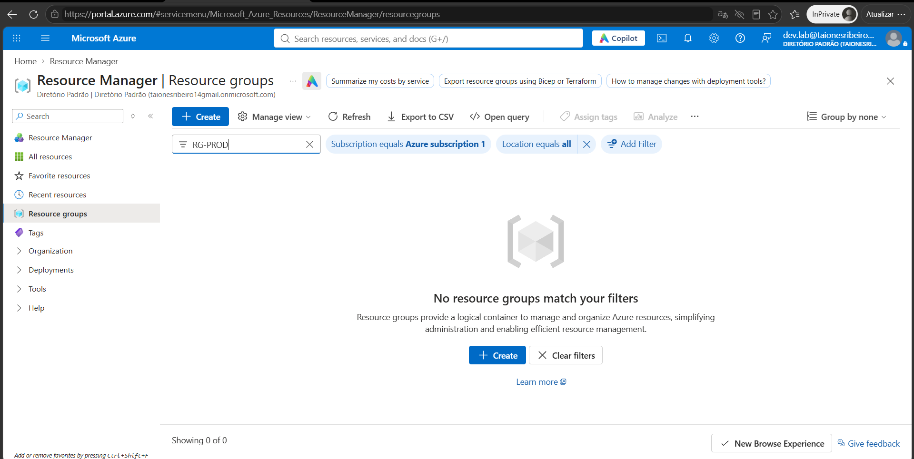
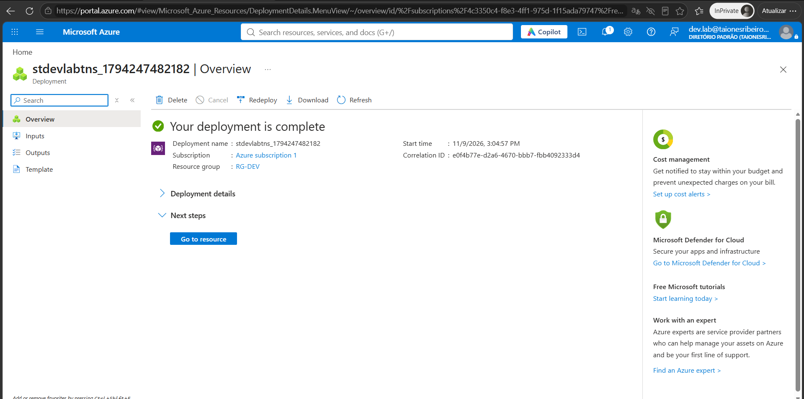
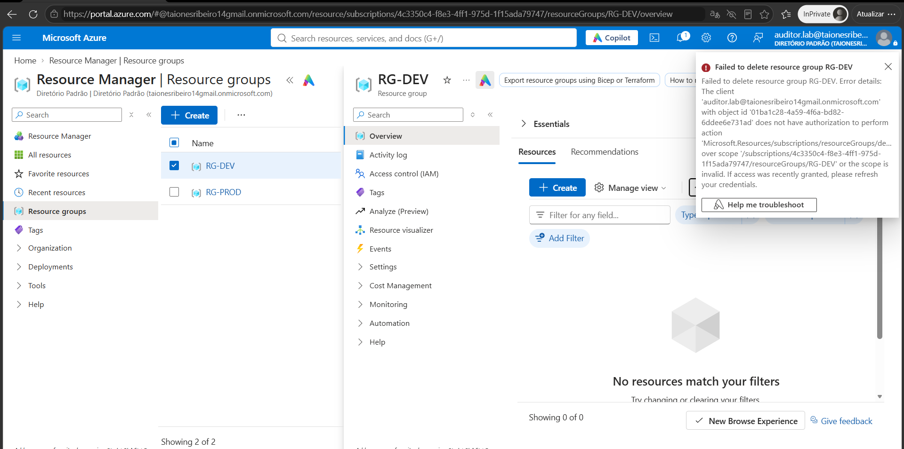

# Azure IAM & RBAC Lab

## Visão Geral

Este projeto foi desenvolvido com o objetivo de praticar conceitos fundamentais de gerenciamento de identidades e acessos (IAM) no Microsoft Azure utilizando Microsoft Entra ID e Azure RBAC (Role-Based Access Control).

O laboratório simula um ambiente corporativo simples, contendo diferentes perfis de usuários, grupos de segurança e níveis de acesso distintos, aplicando o princípio do menor privilégio (Least Privilege) e a segregação de funções (Segregation of Duties).

---

## Objetivos

- Criar e gerenciar usuários no Microsoft Entra ID
- Criar grupos de segurança
- Implementar RBAC no Azure
- Aplicar o princípio do menor privilégio
- Segregar acessos entre equipes
- Validar permissões através de testes práticos
- Documentar evidências e resultados

---

## Tecnologias Utilizadas

- Microsoft Azure
- Microsoft Entra ID (Azure AD)
- Azure Resource Groups
- Azure RBAC (Role-Based Access Control)

---

## Arquitetura do Laboratório

```text
Microsoft Entra ID
│
├── GG-Administradores
│     └── admin.lab
│
├── GG-Infra
│     └── infra.lab
│
├── GG-Dev
│     └── dev.lab
│
└── GG-Auditoria
      └── auditor.lab

Azure Subscription
│
├── RG-DEV
│
└── RG-PROD
```

---

## Usuários Criados

| Usuário | Finalidade |
|----------|------------|
| admin.lab | Administração do ambiente |
| infra.lab | Equipe de Infraestrutura |
| dev.lab | Equipe de Desenvolvimento |
| auditor.lab | Auditoria e Compliance |

---

## Grupos de Segurança

| Grupo | Membro |
|---------|---------|
| GG-Administradores | admin.lab |
| GG-Infra | infra.lab |
| GG-Dev | dev.lab |
| GG-Auditoria | auditor.lab |

---

## Resource Groups

Foram criados dois Resource Groups para simular ambientes distintos:

### RG-DEV

Ambiente destinado ao desenvolvimento e testes.

### RG-PROD

Ambiente destinado à produção.

---

## Implementação de RBAC

### Grupo de Desenvolvimento

| Grupo | Escopo | Função |
|---------|---------|---------|
| GG-Dev | RG-DEV | Contributor |

Permissões:

- Criar recursos
- Alterar recursos
- Excluir recursos

Restrições:

- Sem acesso administrativo
- Sem acesso ao ambiente de produção

---

### Grupo de Infraestrutura

| Grupo | Escopo | Função |
|---------|---------|---------|
| GG-Infra | RG-PROD | Contributor |

Permissões:

- Gerenciamento de recursos de produção

Restrições:

- Sem acesso administrativo da assinatura

---

### Grupo de Auditoria

| Grupo | Escopo | Função |
|---------|---------|---------|
| GG-Auditoria | Subscription | Reader |

Permissões:

- Visualização de recursos
- Consulta de configurações

Restrições:

- Não pode criar, alterar ou excluir recursos

---

## Princípio do Menor Privilégio

O laboratório foi configurado seguindo o conceito de Least Privilege, onde cada usuário recebeu apenas as permissões estritamente necessárias para executar suas atividades.

Exemplos:

- Desenvolvedores possuem acesso apenas ao ambiente de desenvolvimento.
- Infraestrutura possui acesso apenas ao ambiente de produção.
- Auditores possuem apenas leitura.
- Nenhum usuário recebeu permissões excessivas.

---

## Testes Realizados

### Teste 01 - Restrição de Acesso ao Ambiente de Produção

**Usuário:** dev.lab

**Ação:**

Tentativa de acesso ao RG-PROD.

**Resultado Esperado:**

✅ Acesso negado.

---

### Teste 02 - Criação de Recurso em Desenvolvimento

**Usuário:** dev.lab

**Ação:**

Criação de um recurso dentro do RG-DEV.

**Resultado Esperado:**

✅ Operação permitida.

---

### Teste 03 - Exclusão de Recursos pela Auditoria

**Usuário:** auditor.lab

**Ação:**

Tentativa de exclusão de recurso.

**Resultado Esperado:**

✅ Operação bloqueada por falta de permissões.

---

## Evidências

As capturas de tela abaixo demonstram a implementação e validação das configurações realizadas durante o laboratório.

### 1. Visão Geral do Tenant

Arquivo:

```text
evidencias01-tenant-overview.png
```

Demonstra o ambiente Microsoft Entra ID utilizado no laboratório.



---

### 2. Usuários Criados

Arquivo:

```text
evidencias02-users.png
```

Demonstra a criação dos usuários utilizados para simular diferentes funções organizacionais.

Usuários:

- admin.lab
- infra.lab
- dev.lab
- auditor.lab



---

### 3. Grupos de Segurança

Arquivo:

```text
evidencias03-groups.png
```

Demonstra a criação dos grupos de segurança utilizados para atribuição de permissões.

Grupos:

- GG-Administradores
- GG-Infra
- GG-Dev
- GG-Auditoria



---

### 4. Resource Groups

Arquivo:

```text
evidencias04-resources-groups.png
```

Demonstra os Resource Groups criados para segregação dos ambientes.

Ambientes:

- RG-DEV
- RG-PROD



---

### 5. Teste de Permissão - dev.lab

Arquivo:

```text
evidencias05-dev.lab01.png
```

Validação das permissões atribuídas ao usuário da equipe de desenvolvimento.



---

### 6. Teste de Acesso ao Ambiente de Desenvolvimento

Arquivo:

```text
evidencias05-dev.lab02.png
```

Demonstra o usuário dev.lab operando dentro do escopo permitido pelo RBAC.



---

### 7. Configuração RBAC

Arquivo:

```text
evidencias06-dev.lab.png
```

Demonstra a atribuição de função (Role Assignment) ao grupo responsável pelo ambiente de desenvolvimento.



---

### 8. Validação de Auditoria

Arquivo:

```text
evidencias07-auditor.lab.png
```

Demonstra o acesso do usuário auditor.lab com permissões limitadas à função Reader.




As capturas de tela utilizadas para comprovar as implementações estão disponíveis na pasta:

```text
/evidencias

---

## Segurança Aplicada

Durante a construção do laboratório foram utilizados os seguintes conceitos de segurança:

- Identity and Access Management (IAM)
- Role-Based Access Control (RBAC)
- Least Privilege
- Segregation of Duties (SoD)
- Access Control
- Resource Governance

---

## Aprendizados

Este laboratório permitiu compreender na prática:

- Estrutura de identidades no Microsoft Entra ID
- Criação e gerenciamento de grupos de segurança
- Atribuição de funções através de RBAC
- Controle de acesso baseado em escopo
- Validação de permissões em ambientes Azure
- Aplicação de boas práticas de segurança em nuvem

---

## Próximos Passos

Como evolução deste projeto, serão desenvolvidos novos laboratórios focados em:

- Microsoft Defender for Cloud
- Secure Score
- Azure Policy
- Microsoft Sentinel
- Gestão de Vulnerabilidades
- Automação com Python para Azure

---

Projeto desenvolvido como parte dos estudos em Cloud Security e preparação para vagas de:

- Analista de Cibersegurança Cloud
- Analista IAM
- Analista SOC Cloud
- Azure Security Analyst
- Cloud Security Engineer (Júnior)